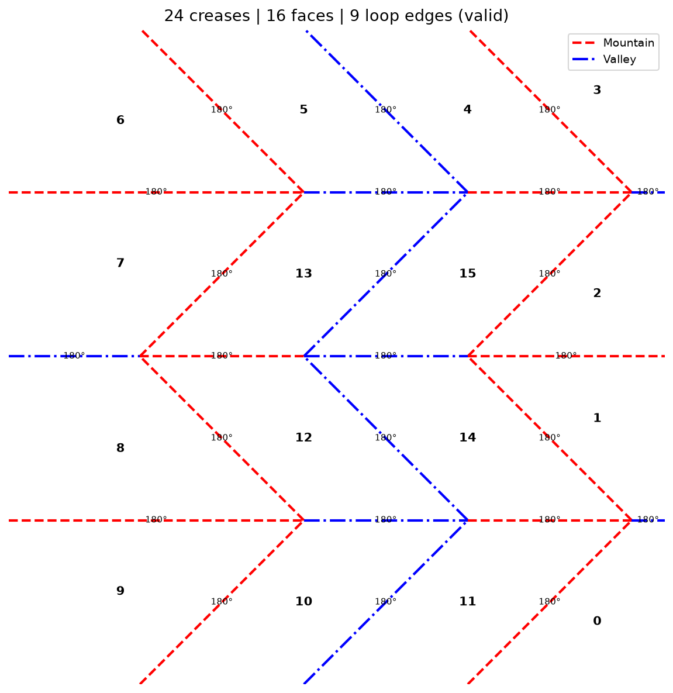

# origami-engine

A Python-based origami folding simulator built around MuJoCo. Reconstruct a crease pattern from 2D line segments, validate the paper topology, generate a MuJoCo model for the folded sheet, apply fold-angle targets, and optionally vibrate the support table to simulate a realistic folding environment.

The code is structured as a **library** rather than a pure toy example, with modularized engine components and clean public APIs.

<p align="center">
  <a href="https://github.com/ihsan31415/origami-engine/releases/latest">
    
  </a>
  <a href="https://pypi.org/project/origami-engine/">
    
  </a>
  <a href="https://github.com/ihsan31415/origami-engine/actions">
    
  </a>
  <a href="https://img.shields.io/badge/license-Apache%202.0-red.svg" alt="License: Apache-2.0">
    
  </a>
  <a href="https://img.shields.io/pyversions-3.10?color=blue" alt="Python 3.10+">
    
  </a>
</p>

---

## 🚀 Getting Started

### Installation

```bash
# Clone the repository
git clone https://github.com/ihsan31415/origami-engine.git
cd origami-engine

# Create a virtual environment and install dependencies
python -m venv .venv
. .venv/bin/activate
pip install -e ".[dev]"
```

### Quick start

```python
from origami_engine import load_default_creases, build_pattern, plot_pattern

# Load the default reference crease pattern
creases = load_default_creases()

# Validate and reconstruct faces/edges
pat = build_pattern(creases)

# Visualize the crease pattern
plot_pattern(creases, pat)
```

See the [Examples](##examples) section for more usage snippets.

---

## 📦 As a Library

This project is structured as a reusable Python library. Core modules are under `origami_engine/`:

| Module | Responsibility |
|---|---|
| `types.py` | Core domain types: `Crease`, `Pattern`, `SimulationResult` |
| `geometry.py` | Reconstruct polygonal faces and hinge graph from creases |
| `model.py` | Assemble MuJoCo XML model from a validated `Pattern` |
| `dynamics.py` | Run MuJoCo simulation, drive table vibration, compute centroids |
| `evaluation.py` | Fitness APIs: `evaluate_individual()`, `evaluate_population()` |
| `plotting.py` | `plot_pattern()` — reference-style crease pattern visualization |
| `simulation.py` | Facade: high-level `run_simulation()` wrapping the pipeline |
| `serialization.py` | Crease JSON I/O, schema validation, normalization |

### Core usage

```python
from origami_engine import (
    Crease,
    Pattern,
    build_pattern,
    generate_xml,
    run_simulation,
    evaluate_individual,
    evaluate_population,
    plot_pattern,
    load_default_creases,
    load_creases_from_json,
    save_creases_to_json,
)
```

---

## 📦 Installation

```bash
pip install -e ".[dev]"
```

Also installable from PyPI:

```bash
pip install origami-engine
```

---

## 📦 Latest Release

See the [GitHub Releases](https://github.com/ihsan31415/origami-engine/releases/latest) page for the most recent version, changelog, and assets.

---

## 📚 Documentation

- [Architecture](ARCHITECTURE.md) — module overview, data flow, design decisions
- [Changelog](CHANGELOG.md) — version history
- [Experimental history](experiments/TIMELINE.md) — archived Jupyter notebooks
- [Crease pattern visualization](##-crease-pattern-visualization) — `plot_pattern` reference

---

## 🔍 Examples

Runnable usage snippets live in the [`examples/`](examples/README.md) folder:

```bash
python examples/01_evaluate_reference.py
python examples/02_json_input.py
python examples/03_inspect_pattern.py
python examples/04_evaluate_population.py
python examples/05_plot_pattern.py
```

---

## 🔍 Crease pattern visualization

View any crease pattern at a glance with `plot_pattern`:

```python
from origami_engine import build_pattern, load_default_creases, plot_pattern

creases = load_default_creases()          # default reference pattern
pat = build_pattern(creases)              # validate faces / edges
plot_pattern(creases, pat)                # Mountain=crimson dashed, Valley=royalblue dash-dot
```

`plot_pattern` draws the sheet between `0.0` and `1.0` on both axes, colours
Mountain folds crimson dashed and Valley folds royalblue dash-dot, labels every
crease with its fold angle in degrees, places gray face indices at each
polygon's representative point, marks loop edges with a black `x`, and prints a
title like `"24 creases | 16 faces | 9 loop edges (x)"`.

Run the example script to open the figure interactively:

```bash
python examples/05_plot_pattern.py
```

A pre-rendered version of the default reference pattern is included in the
repository at [`docs/crease_pattern_plot.png`](docs/crease_pattern_plot.png):

<p align="center">
  
</p>

<p align="center"><sub>Default reference crease pattern — 24 creases | 16 faces | 9 loop edges</sub></p>

---

## 🔍 Example crease input

Crease data is represented as a list of line segments with a start point, end point, and target fold angle. Target angles dictate whether a joint behaves as a **Mountain fold** (negative radians) or a **Valley fold** (positive radians).

```python
from origami_engine.simulation import Crease

creases = [
    Crease((0.2, 0.0), (0.45, 0.25), -0.7853981633974483),
    Crease((0.45, 0.25), (0.2, 0.5), -0.7853981633974483),
]
```

### Explicit Mountain-Valley Fold Pairing

Here is an explicit example of a 90-degree Mountain-Valley fold sequence along a shared crease node to create a standard V-shape:

```python
import numpy as np
from origami_engine.simulation import Crease

crease_sequence = [
    # Crease 1: Mountain Fold (-90 degrees in radians)
    Crease(p1=(0.0, 0.5), p2=(0.5, 0.5), angle=-np.pi / 2),
    # Crease 2: Valley Fold (+90 degrees in radians)
    Crease(p1=(0.5, 0.5), p2=(1.0, 0.5), angle=np.pi / 2),
]
```

The project also supports JSON input with the following schema:

```json
{
  "angle_unit": "degree",
  "creases": [
    { "p1": [0.0, 0.5], "p2": [0.5, 0.5], "angle": -90.0 },
    { "p1": [0.5, 0.5], "p2": [1.0, 0.5], "angle": 90.0 }
  ]
}
```

---

## 📊 Evaluation workflow

The project exposes a small evaluation API over the MuJoCo simulation:

```python
from origami_engine.evaluation import evaluate_individual

score = evaluate_individual(
    creases,
    duration=8.0,
    trajectory=(1.0, 0.0, 0.0),
    fold_duration=3.0,
)
print(score)
```

This returns the forward displacement of the paper centroid relative to the requested trajectory direction, measured after the simulated folding run.

---

## 📦 Package data

- `schemas/*.json` — JSON Schema for crease input validation
- `docs/crease_pattern_plot.png` — pre-rendered reference plot
- `examples/` — runnable usage snippets
- `experiments/` — archived prototyping notebooks (`TIMELINE.md` + `prototype_notebooks.zip`)

---

## 👥 Experimental history

This repository also preserves the **experimental stage** of the simulator before it was modularized into `origami_engine/`. These are the historical Jupyter notebooks (not part of the runtime package) that were used to develop the fold physics:

- [`experiments/TIMELINE.md`](experiments/TIMELINE.md) — phase-by-phase prototyping history (contact optimization, viscoelastic tuning, tear fixes, etc.)
- [`experiments/prototype_notebooks.zip`](experiments/prototype_notebooks.zip) — the archived notebook bundle (`GEN_1` … `GEN_4`)

Unzip the archive and run the notebooks locally:

```bash
unzip experiments/prototype_notebooks.zip -d experiments/notebooks
. .venv/bin/activate
pip install jupyter
jupyter notebook experiments/notebooks
```

---

## 📄 License

Distributed under the [Apache License 2.0](LICENSE).

---

## 🤝 Citation

If you use this work in research, please cite:

```
MuJoCo Origami Simulator (origami-engine). 
GitHub repository: https://github.com/ihsan31415/origami-engine
```

---

## 📬 Contact

- GitHub: [https://github.com/ihsan31415/origami-engine](https://github.com/ihsan31415/origami-engine)
- Author: ihsan <ihsanmuhammadkhoirul@students.unnes.ac.id>